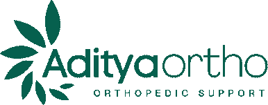

<div align="center">



# Aditya Ortho – Website

**Multi-brand orthopedic support catalogue for a local store in Bokaro Steel City, Jharkhand**


</div>

---

## 📌 About this project

This website was designed and developed as a **client project** for **Aditya Ortho**, an orthopedic support store located at *Laxmi Market, Sector 4, Bokaro Steel City, Jharkhand – 827004*.

The site lets customers browse **418 products from 4 brands** (Samson Orthotics, Tynor, Dynamic Techno Medicals and UM Orthotics), filter them by brand / body part / activity, and send an enquiry for any product directly on **WhatsApp**.

> ⚠️ **Client work notice:** The brand name, logo, product names and product images belong to Aditya Ortho and the respective brand owners. This repository is shared for portfolio / delivery purposes only. Please do not copy or reuse the branding or product content without permission.

---

## ✨ Features

- 🛍️ **Product catalogue** – 418 products, search, brand filter, body-part filter, sorting and "Show more" paging
- 💬 **WhatsApp enquiry** button on every product (pre-filled message with product name & brand)
- 📱 **Fully responsive** – tested from 360 px phones to 1536 px desktops
- 🧭 **Mega menus** (Body part / Activity / Daily support / Brand) and an accessible mobile drawer
- 🎞️ **Animations** – hero entrance, count-up stats, scroll progress bar, card tilt & hover effects, smooth FAQ
- ♿ **Accessibility** – keyboard navigation, skip link, ARIA states, and full `prefers-reduced-motion` support
- 🔍 **SEO ready** – meta tags, canonical, Open Graph / Twitter cards, JSON-LD (LocalBusiness, FAQ, Breadcrumb, ItemList), sitemap & robots.txt
- 🔗 **Shareable filters** – e.g. `products.html?category=Knee&brand=Tynor`
- 📍 Google Maps embed and directions for the store

---

## 🧰 Tech stack

Plain **HTML5 · CSS3 · Vanilla JavaScript** – no framework, no build step, no dependencies.
Fonts: *DM Sans* & *Manrope* (Google Fonts).

---

## 📁 Project structure

```
├── index.html              # Home page
├── products.html           # Catalogue page
├── css/                    # Stylesheets (motion.css & responsive-final.css load last)
├── js/
│   ├── shared.js           # Categories, helpers, catalogue loader
│   ├── main.js             # Header, menus, drawer, scroll reveal, featured products
│   ├── products.js         # Catalogue: search, filters, paging, URL sync
│   ├── nav-enhance.js      # Keyboard / focus enhancements
│   └── motion.js           # Scroll progress, count-up, card tilt
├── data/
│   ├── products.json       # Product data
│   └── products.js         # Same data (keep both in sync)
├── assets/                 # Logos, banners, product images
├── robots.txt · sitemap.xml · site.webmanifest · favicon.ico
├── set_domain.py           # Replaces the placeholder domain before going live
└── CHANGELOG.md            # Detailed audit & change notes
```

---

## 🚀 Run locally

**Option 1 – Windows:** double-click `run_website.bat`

**Option 2 – any OS (Python installed):**
```bash
python -m http.server 8000
```
Then open <http://127.0.0.1:8000/index.html>

> Open it through a local server (not by double-clicking the HTML file) so the product data loads correctly.

---

## ✏️ Editing products

Each product in `data/products.json` looks like:

```json
{ "brand": "Tynor", "name": "Ankle Support (Neo)", "sizes": [], "image": "assets/products/..." }
```

1. Add / edit the product in **`data/products.json`**
2. Make the same change in **`data/products.js`** (it is the same data wrapped in `window.CATALOGUE = [...]`)
3. Put the image in `assets/products/<brand>/`

The WhatsApp number is set in `js/shared.js` (`WA_NUMBER`) and in the links inside the HTML files.

---

## 🌐 Deploying

The site is static, so it can be hosted for free on **GitHub Pages**, Netlify, Vercel or Cloudflare Pages.

Before going live, replace the placeholder domain used in canonical / social tags / sitemap:

```bash
python set_domain.py https://your-real-domain.com
```

---

## 📞 Client contact

| | |
|---|---|
| **Business** | Aditya Ortho – Orthopedic Support Store |
| **Address** | Laxmi Market, Sector 4, Bokaro Steel City, Jharkhand 827004 |
| **Phone / WhatsApp** | +91 86511 28309 |

---

## 👨‍💻 Developer

Designed & developed by **YOUR NAME** – [GitHub](https://github.com/YOUR-USERNAME) · [LinkedIn](https://linkedin.com/in/YOUR-PROFILE)

© 2026 Aditya Ortho. All rights reserved.
